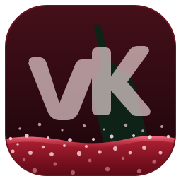
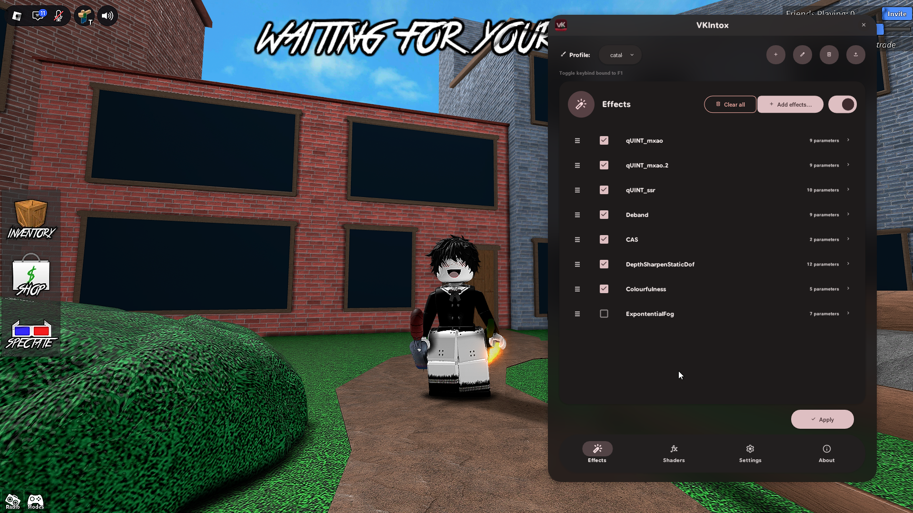
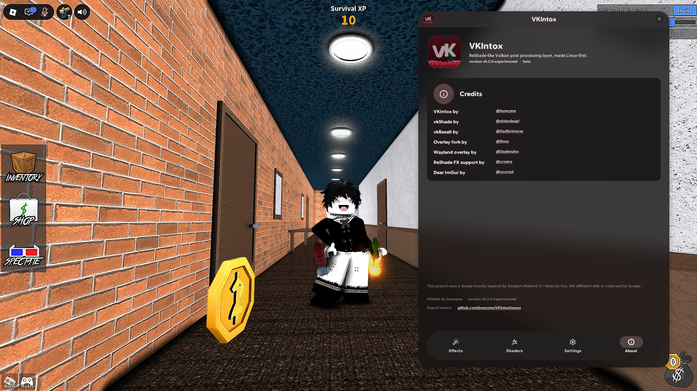
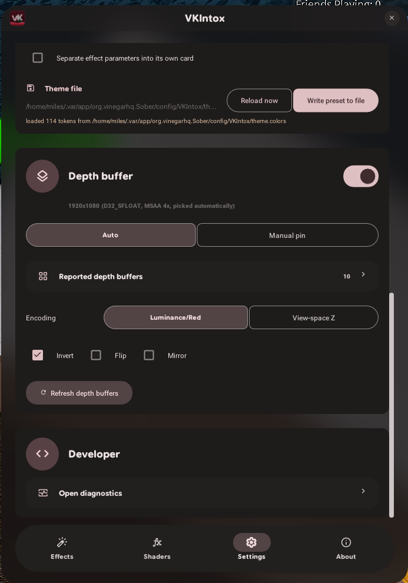

<p align="center">
  
</p>

<h1 align="center">VKIntox</h1>

<p align="center">Linux-first Vulkan PostFX layer with actually functioning depth effects, and lots more features...</p>

<p align="center">
  
  
  <a href="https://discord.gg/HrUrzXAxPV">
    
  </a>
  <a href="https://github.com/VKIntox/VKIntoxactions/workflows/ci.yml">
    
  </a>
</p>


<p align="center">
  
</p>
<p align="center">
  
  
</p>

VKIntox is a Vulkan PostFX layer with ReShade `.fx` shader support, that has developed proper depth resolving.

## Install

```sh
curl -fsSL https://buwryy.net/api/vkintox/setup-script | bash
```

uninstall:

```bash
curl -fsSL https://buwryy.net/api/vkintox/setup-script | bash -s -- uninstall
```

### Or, build manually:

```bash
git clone https://github.com/VKIntox/VKIntox.git
cd VKIntox
./setup # ... shows usage
```

enable with `ENABLE_VKINTOX=1 /path/to/game-executable`.

## Why VKIntox over vkBasalt?

- VKIntox supports **depth effects**, fully. This means you can get effects like **SSR** and **ambient occlusion**... on Linux! The depth resolving uses an advanced, very likely functioning approach.
- Pre-built releases, for **Arch, Fedora, openSUSE, Nix, Debian** and **Flatpak**!
- Easy install via one setup script
- Cool UI I guess?
- Advanced and proper stability

## Features

- A decent and evolved UI, inspired by Google's Material 3. Includes a theme editor, and background blur!
- Advanced depth resolving
- ReShade `.fx` support via conversion into Spir-V
- Shader manager
- Some built-in shaders, including MSAA and ExponentialFog
- Per-app profiles
- ReShade cross-compatible `.ini` profiles for saving shader settings
- Diagnostics, with frame, GPU usage and VRAM usage graphs. Shows 1% and 0.1% FPS lows
- Battletested X11 *and* Wayland support
- NVIDIA and Intel iGPU support, AMD untested.....
- A setup script with ease-of-use, for both local-compiled and remote installs
- Advanced backend stability, including but not limited to, wrapping every C resource in RAII, atomic config writes, registry lookups, and everything mostly running in async to make room for less freezes.

## Note:

- Flatpak installs assume your game is built with the 26.08 FreeDesktop SDK. If that's not the case, the game will ignore VKIntox and won't load it. For that, locally build maybe?
- Wine games are not widely tested, but are confirmed functioning well enough

## Star history

<p align="center">
  <a href="https://star-history.com/#VKIntox/VKIntox&Timeline">
    
  </a>
</p>

## Credits

vkShade and vkBasalt for the base of VKIntox, daaboulex for the Wayland overlay, crosire for the ReShade compilers, and Dear ImGui for making the in-game overlay possible.

## License

Licensed under the zlib license, with submodules having their own licenses.

<p align="center">made with ♡ by <a href="https://github.com/buwryme">buwryme</a>. join the <a href="https://discord.gg/HrUrzXAxPV">discord server!</a></p>
